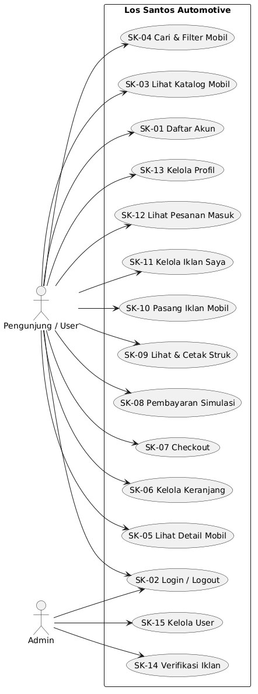
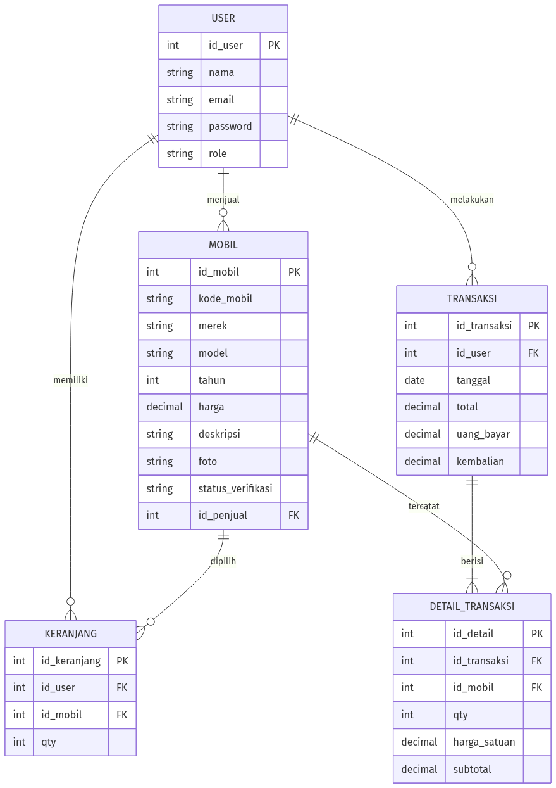

# SKPL — Los Santos Automotive
**Spesifikasi Kebutuhan Perangkat Lunak**
Versi 1.0 (draft) · 26 September 2026

**Mata Kuliah:** Implementasi dan Pengujian Perangkat Lunak (CAK3BAB3)
**Kelompok 8:** Fikri Ahmad Zidane (2211102336) · Ananda Tegar Pratama Saulaka (2211102356)
**TUBES:** Los Santos Automotive — marketplace jual-beli mobil berbasis web

---

## 1. Pendahuluan

### 1.1 Tujuan Dokumen
Dokumen ini mendefinisikan kebutuhan perangkat lunak untuk aplikasi **Los Santos Automotive**, yaitu aplikasi web marketplace jual-beli mobil. Dokumen ini menjadi acuan tim dalam tahap perancangan (DPPL), implementasi, dan pengujian perangkat lunak, serta menjadi dasar penilaian kesesuaian hasil implementasi terhadap kebutuhan.

### 1.2 Ruang Lingkup
- **Nama produk:** Los Santos Automotive
- **Jenis:** aplikasi web (berjalan di browser, server lokal via Docker)
- **Pengguna:** pembeli, penjual (satu akun pengguna dapat berperan keduanya), dan admin
- **Fitur inti:** katalog mobil, pencarian & filter, keranjang, checkout, pembayaran simulasi (hitung kembalian), struk/invoice, pengelolaan iklan mobil, verifikasi iklan oleh admin
- **Di luar ruang lingkup:** pembayaran asli (payment gateway), pengiriman kendaraan, chat realtime, aplikasi mobile native

### 1.3 Definisi, Akronim, dan Singkatan
| Istilah | Arti |
|---|---|
| SKPL | Spesifikasi Kebutuhan Perangkat Lunak (dokumen ini) |
| DPPL | Deskripsi Perancangan Perangkat Lunak |
| ERD | Entity Relationship Diagram |
| POS | Point of Sale (fitur transaksi: barang, jumlah, bayar, struk) |
| User | Pengguna terdaftar yang dapat membeli dan menjual mobil |
| Admin | Pengguna dengan hak akses pengelolaan iklan dan user |
| Struk | Bukti transaksi pembelian yang dapat dicetak/diunduh |

### 1.4 Referensi
1. RPS Mata Kuliah Implementasi dan Pengujian Perangkat Lunak (CAK3AAB3), Program Studi Informatika — Telkom University
2. Materi kuliah "Software Construction Planning" (minggu 1)
3. Pressman, R. S. — *Software Engineering: A Practitioner's Approach*
4. Repositori kelompok: GitHub (organisasi kelompok 8) dan papan pemantauan Trello "Los Santos Automotive"

---

## 2. Deskripsi Umum

### 2.1 Perspektif Produk
Los Santos Automotive adalah produk mandiri (stand-alone) berbasis web yang dikembangkan sebagai kelanjutan topik tugas besar dari mata kuliah sebelumnya. Aplikasi dibangun dengan arsitektur client-server: antarmuka web (browser) berkomunikasi dengan server aplikasi yang terhubung ke basis data PostgreSQL. Pengguna mengakses satu kesatuan sistem; pemisahan hak akses dilakukan melalui peran (role) pada akun.

### 2.2 Ringkasan Fungsi Produk
| Kode | Fungsi | Deskripsi Singkat |
|---|---|---|
| SK-01 | Registrasi akun | Pengguna baru membuat akun (nama, email, password) |
| SK-02 | Login & logout | Autentikasi pengguna dan admin |
| SK-03 | Katalog mobil | Menampilkan daftar mobil yang telah terverifikasi |
| SK-04 | Pencarian & filter | Mencari mobil berdasarkan merek, rentang harga, dan tahun |
| SK-05 | Detail mobil | Menampilkan spesifikasi lengkap dan foto mobil |
| SK-06 | Keranjang | Menambah, melihat, dan menghapus mobil dari keranjang |
| SK-07 | Checkout | Menghitung total pembayaran dari isi keranjang |
| SK-08 | Pembayaran simulasi | Input uang bayar, menghitung kembalian |
| SK-09 | Struk | Menampilkan dan mencetak bukti transaksi |
| SK-10 | Pasang iklan mobil | Penjual mengunggah data mobil yang akan dijual |
| SK-11 | Kelola iklan | Penjual mengubah/menghapus iklan miliknya |
| SK-12 | Pesanan masuk | Penjual melihat daftar pesanan atas mobilnya |
| SK-13 | Kelola profil | Pengguna mengubah data profil |
| SK-14 | Verifikasi iklan | Admin menyetujui/menolak iklan yang masuk |
| SK-15 | Kelola user | Admin melihat dan menghapus user |

### 2.3 Karakteristik Pengguna
| Aktor | Karakteristik | Hak Akses Utama |
|---|---|---|
| User (pembeli/penjual) | Masyarakat umum, terbiasa menggunakan browser | Cari & beli mobil, pasang iklan, kelola profil |
| Admin | Operator sistem | Verifikasi iklan, kelola user |

### 2.4 Batasan Umum
1. Berbasis web; dijalankan pada browser modern (Chrome/Firefox/Brave).
2. Teknologi: Node.js + Express, PostgreSQL, Prisma ORM, EJS + Bootstrap 5.
3. Server lokal dijalankan dengan Docker Compose.
4. Pembayaran hanya berupa simulasi (tidak terhubung payment gateway).
5. Antarmuka berbahasa Indonesia.

### 2.5 Asumsi dan Ketergantungan
1. Data mobil diisi oleh penjual; iklan baru tampil setelah diverifikasi admin.
2. Setiap transaksi hanya dapat dilakukan oleh user yang sudah login.
3. Aplikasi diasumsikan diakses satu pengguna per sesi (single session per browser).
4. Data contoh (seed) disediakan untuk keperluan demonstrasi.

---

## 3. Kebutuhan Fungsional

| Kode | Nama Kebutuhan | Deskripsi | Aktor | Prioritas |
|---|---|---|---|---|
| SK-01 | Registrasi akun | Sistem menyediakan form pendaftaran; email harus unik; password disimpan dalam bentuk hash | User | Tinggi |
| SK-02 | Login & logout | Sistem memverifikasi email dan password, membuat sesi login, dan menyediakan logout | User, Admin | Tinggi |
| SK-03 | Katalog mobil | Sistem menampilkan daftar mobil berstatus terverifikasi beserta harga dan foto utama | User | Tinggi |
| SK-04 | Pencarian & filter | Sistem memfilter daftar mobil berdasarkan kata kunci merek/model, rentang harga, dan tahun | User | Tinggi |
| SK-05 | Detail mobil | Sistem menampilkan detail: kode mobil, merek, model, tahun, harga, deskripsi, dan foto | User | Tinggi |
| SK-06 | Keranjang | Sistem menyimpan mobil yang dipilih user; user dapat melihat, menambah jumlah, dan menghapus item | User | Tinggi |
| SK-07 | Checkout | Sistem menampilkan ringkasan keranjang dan menghitung total harga seluruh item | User | Tinggi |
| SK-08 | Pembayaran simulasi | User memasukkan jumlah uang bayar; sistem menghitung dan menampilkan kembalian | User | Tinggi |
| SK-09 | Struk | Sistem menampilkan struk transaksi dan menyediakan fitur cetak (print/PDF) | User | Tinggi |
| SK-10 | Pasang iklan | Penjual mengisi form iklan: kode mobil, merek, model, tahun, harga, deskripsi, dan foto; status awal "menunggu verifikasi" | User | Tinggi |
| SK-11 | Kelola iklan | Penjual dapat mengubah dan menghapus iklan miliknya | User | Sedang |
| SK-12 | Pesanan masuk | Penjual melihat daftar transaksi yang memuat mobilnya | User | Sedang |
| SK-13 | Kelola profil | User mengubah nama, email, dan password akunnya | User | Sedang |
| SK-14 | Verifikasi iklan | Admin melihat daftar iklan berstatus menunggu dan dapat menyetujui atau menolak | Admin | Tinggi |
| SK-15 | Kelola user | Admin melihat daftar user dan dapat menghapus user | Admin | Rendah |

---

## 4. Kebutuhan Non-Fungsional

| Kode | Kategori | Deskripsi |
|---|---|---|
| NFR-01 | Performa | Halaman utama tampil dalam waktu kurang dari 3 detik pada jaringan lokal |
| NFR-02 | Keamanan | Password disimpan ter-hash; halaman user/admin dilindungi sesi login; akses admin dipisahkan berdasarkan peran; input divalidasi di server |
| NFR-03 | Usability | Tampilan responsif (mobile-first) menggunakan Bootstrap; teks berbahasa Indonesia; navigasi maksimal 3 klik menuju transaksi |
| NFR-04 | Ketersediaan | Aplikasi berjalan stabil pada lingkungan Docker Compose (app + database) |
| NFR-05 | Maintainability | Struktur kode mengikuti pola MVC (routes, controllers, views); penamaan konsisten; komentar pada bagian penting |
| NFR-06 | Portabilitas | Dapat dijalankan di Linux/Windows selama Docker tersedia |

---

## 5. Kebutuhan Antarmuka Eksternal

### 5.1 Antarmuka Pengguna (Halaman & Rute)
| Rute | Halaman | Akses |
|---|---|---|
| / | Beranda (katalog unggulan) | Publik |
| /mobil | Katalog mobil + pencarian & filter | Publik |
| /mobil/:id | Detail mobil | Publik |
| /register, /login | Registrasi dan login | Publik |
| /profile | Profil user | User |
| /keranjang | Keranjang | User |
| /checkout | Checkout & pembayaran | User |
| /struk/:id | Struk/invoice | User |
| /jual, /jual/kelola | Pasang iklan & kelola iklan | User |
| /pesanan | Pesanan masuk | User |
| /admin | Dashboard admin | Admin |
| /admin/iklan | Verifikasi iklan | Admin |
| /admin/user | Kelola user | Admin |

### 5.2 Antarmuka Perangkat Lunak
- Basis data: PostgreSQL (kontainer Docker)
- ORM: Prisma
- Runtime: Node.js + Express dengan template engine EJS

### 5.3 Antarmuka Komunikasi
- Protokol HTTP melalui jaringan lokal/host (localhost)
- Format data antar lapisan: HTML (render server) dan JSON (untuk operasi AJAX sederhana bila diperlukan)

### 5.4 Antarmuka Perangkat Keras
- Komputer/laptop standar dengan browser modern; tidak memerlukan perangkat khusus

---

## 6. Model Analisis

### 6.1 Use Case Diagram
Diagram berikut menggambarkan seluruh interaksi antara aktor (User dan Admin) dengan fungsi-fungsi yang disediakan sistem Los Santos Automotive.

**Daftar use case:**
| Kode | Nama Use Case | Aktor |
|---|---|---|
| SK-01 | Daftar Akun | User |
| SK-02 | Login / Logout | User, Admin |
| SK-03 | Lihat Katalog Mobil | User |
| SK-04 | Cari & Filter Mobil | User |
| SK-05 | Lihat Detail Mobil | User |
| SK-06 | Kelola Keranjang | User |
| SK-07 | Checkout | User |
| SK-08 | Pembayaran Simulasi | User |
| SK-09 | Lihat & Cetak Struk | User |
| SK-10 | Pasang Iklan Mobil | User |
| SK-11 | Kelola Iklan Saya | User |
| SK-12 | Lihat Pesanan Masuk | User |
| SK-13 | Kelola Profil | User |
| SK-14 | Verifikasi Iklan | Admin |
| SK-15 | Kelola User | Admin |

*Sumber diagram: `img/use-case.puml`*

### 6.2 Skenario Use Case Utama — Checkout & Pembayaran (SK-07, SK-08, SK-09)
| Bagian | Keterangan |
|---|---|
| Nama use case | Checkout & Pembayaran |
| Aktor | User (pembeli) |
| Pra-kondisi | User sudah login dan keranjang berisi minimal satu mobil |
| Alur utama | 1. User membuka halaman keranjang; 2. User menekan tombol Checkout; 3. Sistem menampilkan ringkasan item dan total; 4. User memasukkan jumlah uang bayar; 5. Sistem menghitung kembalian; 6. User menekan tombol Bayar; 7. Sistem menyimpan transaksi dan menampilkan struk; 8. User mencetak/mengunduh struk |
| Alur alternatif | 4a. Uang bayar kurang dari total — sistem menolak dan menampilkan pesan; 1a. Keranjang kosong — tombol checkout dinonaktifkan |
| Pasca-kondisi | Transaksi tersimpan, isi keranjang dibersihkan, struk dapat dicetak |

### 6.3 Skenario Use Case Utama — Verifikasi Iklan (SK-14)
| Bagian | Keterangan |
|---|---|
| Nama use case | Verifikasi Iklan |
| Aktor | Admin |
| Pra-kondisi | Admin sudah login; terdapat iklan berstatus "menunggu verifikasi" |
| Alur utama | 1. Admin membuka daftar iklan pending; 2. Admin memeriksa data iklan; 3. Admin menekan Setujui; 4. Sistem mengubah status iklan sehingga tampil di katalog |
| Alur alternatif | 3a. Admin menolak iklan — status menjadi "ditolak" dan tidak tampil di katalog |
| Pasca-kondisi | Status iklan diperbarui |

### 6.4 Entity Relationship Diagram (ERD)
Diagram berikut menggambarkan struktur basis data beserta relasi antar tabel yang digunakan oleh aplikasi.

*Sumber diagram: `img/erd.mmd`*

| Entitas | Deskripsi | Atribut Utama |
|---|---|---|
| User | Akun pengguna (user & admin) | id_user, nama, email, password, role |
| Mobil | Data mobil yang diiklankan | id_mobil, kode_mobil, merek, model, tahun, harga, deskripsi, foto, status_verifikasi, id_penjual |
| Keranjang | Item mobil pilihan user sebelum checkout | id_keranjang, id_user, id_mobil, qty |
| Transaksi | Kepala transaksi pembelian | id_transaksi, id_user, tanggal, total, uang_bayar, kembalian |
| Detail_Transaksi | Rincian mobil per transaksi | id_detail, id_transaksi, id_mobil, qty, harga_satuan, subtotal |

### 6.5 Kamus Data

**Tabel: user**
| Kolom | Tipe | Keterangan |
|---|---|---|
| id_user | SERIAL (PK) | ID unik pengguna (auto increment) |
| nama | VARCHAR(100) | Nama lengkap pengguna |
| email | VARCHAR(100), UNIQUE | Email untuk login — harus unik |
| password | VARCHAR(255) | Password dalam bentuk hash (bcrypt) |
| role | VARCHAR(10) | Peran pengguna: "user" atau "admin" |

**Tabel: mobil**
| Kolom | Tipe | Keterangan |
|---|---|---|
| id_mobil | SERIAL (PK) | ID unik mobil |
| kode_mobil | VARCHAR(20), UNIQUE | Kode unik mobil — dipakai saat menambah ke keranjang |
| merek | VARCHAR(50) | Merek mobil (contoh: Toyota, Honda) |
| model | VARCHAR(50) | Model/tipe mobil |
| tahun | INT | Tahun produksi |
| harga | NUMERIC(12,2) | Harga jual (Rupiah) |
| deskripsi | TEXT | Deskripsi kondisi dan spesifikasi |
| foto | VARCHAR(255) | Nama file foto utama |
| status_verifikasi | VARCHAR(15) | "pending", "disetujui", atau "ditolak" |
| id_penjual | INT (FK → user.id_user) | Penjual yang memasang iklan |

**Tabel: keranjang**
| Kolom | Tipe | Keterangan |
|---|---|---|
| id_keranjang | SERIAL (PK) | ID unik baris keranjang |
| id_user | INT (FK → user.id_user) | Pemilik keranjang |
| id_mobil | INT (FK → mobil.id_mobil) | Mobil yang dipilih |
| qty | INT | Jumlah unit (umumnya 1) |

**Tabel: transaksi**
| Kolom | Tipe | Keterangan |
|---|---|---|
| id_transaksi | SERIAL (PK) | ID unik transaksi |
| id_user | INT (FK → user.id_user) | Pembeli |
| tanggal | TIMESTAMP | Waktu transaksi dibuat |
| total | NUMERIC(14,2) | Total nilai transaksi |
| uang_bayar | NUMERIC(14,2) | Jumlah uang yang dibayarkan pembeli |
| kembalian | NUMERIC(14,2) | uang_bayar − total |

**Tabel: detail_transaksi**
| Kolom | Tipe | Keterangan |
|---|---|---|
| id_detail | SERIAL (PK) | ID unik rincian |
| id_transaksi | INT (FK → transaksi.id_transaksi) | Transaksi induk |
| id_mobil | INT (FK → mobil.id_mobil) | Mobil yang dibeli |
| qty | INT | Jumlah unit |
| harga_satuan | NUMERIC(12,2) | Harga saat transaksi (snapshot) |
| subtotal | NUMERIC(14,2) | qty × harga_satuan |

**Relasi antar tabel:**
- Satu **user** dapat menjual banyak **mobil** (1 : N)
- Satu **user** memiliki banyak baris **keranjang** (1 : N)
- Satu **user** melakukan banyak **transaksi** (1 : N)
- Satu **transaksi** memiliki satu atau lebih **detail_transaksi** (1 : N)

---

## 7. Catatan Versi
| Versi | Tanggal | Perubahan |
|---|---|---|
| 1.0 (draft) | 26 Sep 2026 | Draft awal: pendahuluan, deskripsi umum, kebutuhan fungsional & non-fungsional, antarmuka, model analisis |

> **Catatan draft:** silakan koreksi bagian yang perlu (nama fitur, prioritas, skenario) sebelum diserahkan pada responsi.
